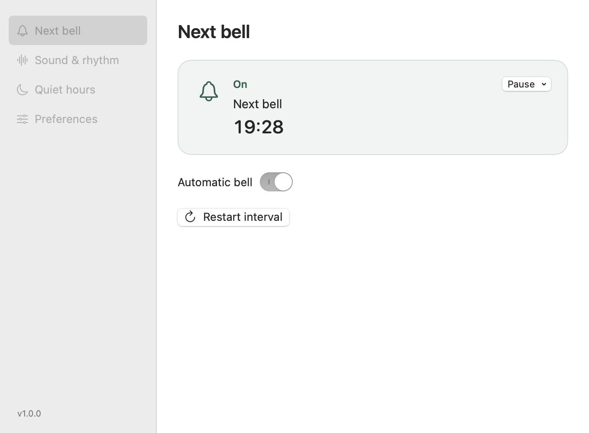
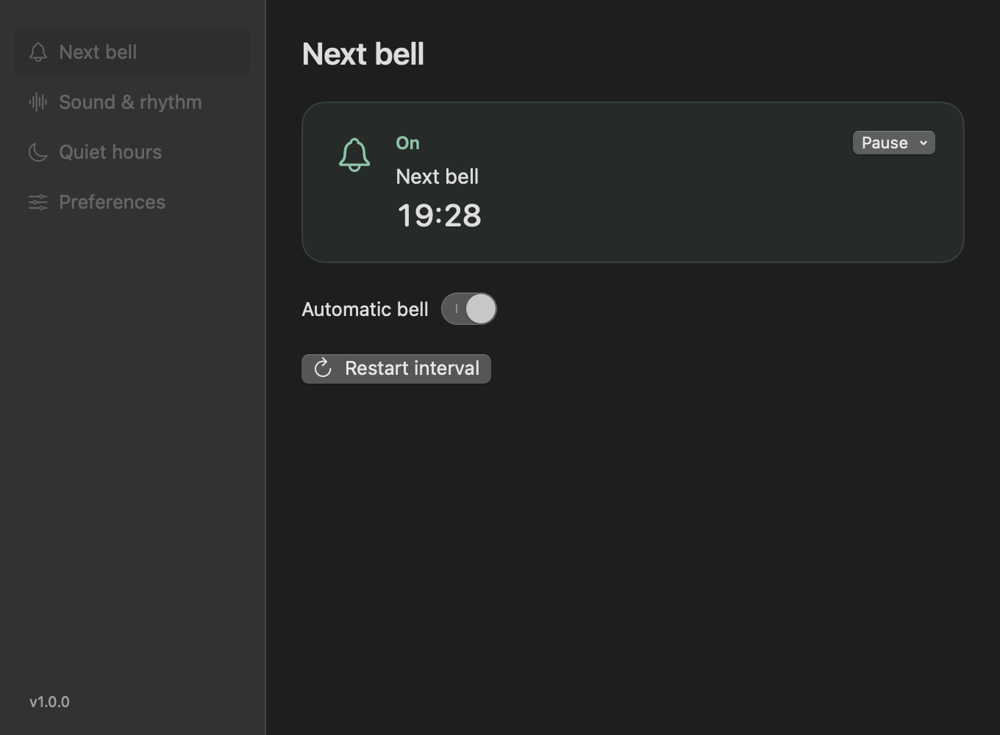

# Bell of Mindfulness


A quiet reminder to pause and return to the present. Plays a singing bowl at your chosen interval.

**macOS 14+ · Apple Silicon and Intel · English / Deutsch**

## Install

With Homebrew:

```sh
brew tap gslava/bell-of-mindfulness https://github.com/gslava/Bell-of-Mindfulness.git
brew install --cask gslava/bell-of-mindfulness/bell-of-mindfulness
```

To update, quit the app, run the following, then reopen it from Applications:

```sh
brew update
brew upgrade --cask gslava/bell-of-mindfulness/bell-of-mindfulness
```

Or install manually:

Download the latest **DMG or ZIP** from [Releases](https://github.com/gslava/Bell-of-Mindfulness/releases/latest). Open the DMG and drag **Bell of Mindfulness.app** to **Applications**, or unzip and move the app there. Launch it from Applications.

> **First launch:** the app is ad-hoc signed and not notarized by Apple. If macOS blocks it, dismiss the alert. If you trust the download, open **System Settings → Privacy & Security → Open Anyway**, then confirm **Open**. See [Apple’s instructions](https://support.apple.com/en-us/102445).

## Use

- **Next bell:** see the next playback time, turn automatic bells on or off, pause for 30 minutes or an hour, or restart the interval.
- **Sound & rhythm:** choose an interval of **1–1,440 minutes** and adjust playback volume. Defaults: **30 minutes**, **50% volume**. Use **Preview sound** to listen or stop playback.
- **Quiet hours:** add, edit, disable, or delete silent periods with selected weekdays. The default is **21:00–08:00 every day**. Overnight periods belong to their starting day.
- **Preferences:** switch between **EN / DE** and optionally enable **Launch at login**. Settings save automatically.

Click the bowl in the **menu bar** for quick controls or to reopen Settings. With the window open, the app appears in **Dock and Command+Tab**. Closing the window keeps the bell running in the menu bar; the menu’s power button quits the app.

After waking, resuming, or leaving quiet hours, a fresh interval begins. Missed bells are skipped. Manual previews work during quiet hours. Playback volume is relative to your Mac’s system volume and mute setting.

<p>
  
  
</p>

## License

Code and icons: [MIT](LICENSE). The bundled recording is excluded; see the [audio notice](THIRD_PARTY_NOTICES.md).
